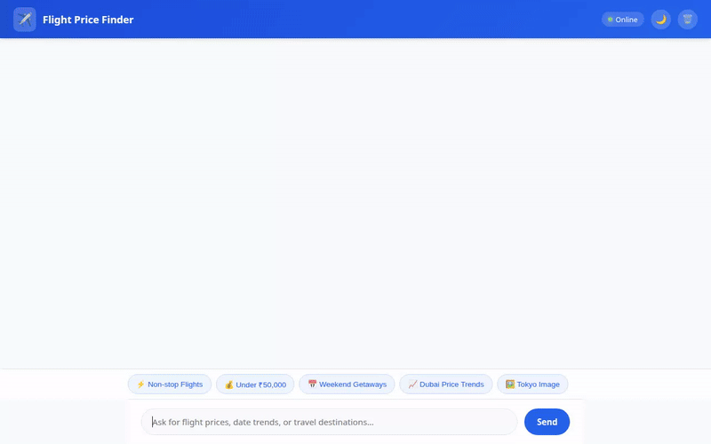

# Flight & Travel Price Finder ✈️🇮🇳

An AI-powered agent specialized in flight deal discovery, price trend analysis, multi-currency conversion, and promotional media generation for departures out of **Mumbai, India (BOM - Chhatrapati Shivaji Maharaj International Airport)**.



---

## 🌟 What This Agent Does

Flight & Travel Price Finder acts as a travel discovery assistant tailored for Mumbai travelers. It tracks deal prices in **Indian Rupees (INR ₹)**, helps analyze optimal travel departure windows, remembers traveler preferences across sessions, and generates visual destination assets.

### 🛠️ Built-in Capabilities & Tools

- **✈️ Flight Deal Search (`search_flight_deals`)**: Queries real flight deal entries stored in **Google Cloud Firestore** filtered by destination, maximum price in INR ₹, and travel month.
- **➕ Flight Deal Ingestion (`add_flight_deal`)**: Allows adding new verified flight deal entries (airline, price in INR, departure date, seating class) into the Firestore database.
- **📈 Travel Date & Price Analysis (`analyze_travel_dates`)**: Analyzes departure date ranges and calculates average prices, lowest price windows, and maximum potential savings in INR.
- **💱 Live Currency Conversion (`convert_flight_currency`)**: Fetches real-time exchange rates to convert INR prices to foreign currencies (USD, EUR, GBP, AED, JPY, SGD).
- **🖼️ Destination Image Generator (`generate_destination_image`)**: Uses **`gemini-3.1-flash-lite-image`** to generate promotional travel posters, saves the image as an ADK artifact, uploads the bytes to **Google Cloud Storage**, and returns a public HTTPS URL.
- **🎥 Destination Video Generator (`generate_destination_video`)**: Uses Google's Omni model **`gemini-omni-flash-preview`** (via Vertex AI global region Interactions API) to generate cinematic short promotional videos, saves the video as an ADK artifact, and hosts it on Google Cloud Storage.
- **🧠 Cross-Session Long-Term Memory (`PreloadMemoryTool`)**: Uses **Vertex AI Memory Bank** to automatically retain and apply user preferences (e.g., home airport BOM, seating preferences, budget constraints, preferred destinations) across sessions.
- **🧮 Python Code Execution**: Integrates with **Agent Engine Sandbox Code Executor** to run Python code for mathematical operations and statistical analysis.
- **🎨 A2UI Rich UI Rendering**: Renders flat, structured component cards (Cards, Columns, Rows, Text, Images) using the A2UI Schema Manager (v0.8 basic catalog).

---

## ☁️ Google Cloud & Architecture Integration

```
               +----------------------------------+
               |  FastAPI Web Proxy & Chat UI     |
               |  (A2A Protocol Client)           |
               +----------------+-----------------+
                                |
                                v
               +----------------------------------+
               |   Vertex AI Agent Engine         |
               |   (ADK Python Runtime)           |
               +----------------+-----------------+
                                |
      +-------------------------+-------------------------+
      |                         |                         |
      v                         v                         v
+-----------+            +--------------+          +--------------+
| Firestore |            |  Vertex AI   |          | Cloud Storage|
| Database  |            | Memory Bank  |          | Media Bucket |
+-----------+            +--------------+          +--------------+
```

- **Vertex AI Agent Engine (Agent Development Kit / ADK)**: Manages agent lifecycle, tool execution, system prompts, and memory callbacks.
- **Google Cloud Firestore**: Persists flight deal documents under the `flight_deals` collection (`qwiklabs-gcp-03-3303f858f7df`).
- **Vertex AI Memory Bank**: Provides serverless vector-backed long-term memory (`VertexAiMemoryBankService`) for user preferences.
- **Google Cloud Storage**: Public bucket (`flight-price-finder-media-3303f858f7df`) hosting generated images and video media assets.
- **Vertex AI Gemini Models**:
  - `gemini-flash-latest` (Orchestration & Reasoning)
  - `gemini-3.1-flash-lite-image` (Image Generation)
  - `gemini-omni-flash-preview` (Video Generation)

---

## 🚀 Local Development & Setup

### Prerequisites

- Python 3.11+
- Google Cloud SDK (`gcloud`) authenticated with access to Vertex AI, Firestore, and Cloud Storage.

### Environment Setup

1. **Clone the repository**:
   ```bash
   git clone <your-repo-url>
   cd flight-price-finder
   ```

2. **Install dependencies**:
   ```bash
   pip install -r requirements.txt
   ```

3. **Configure Environment Variables**:
   ```bash
   export AGENT_ENGINE_RESOURCE_NAME="projects/<PROJECT_NUMBER>/locations/<LOCATION>/reasoningEngines/<RESOURCE_ID>"
   export AGENT_DIRECTORY="app"
   ```

### Running the Application

1. **Start the FastAPI Proxy & Chat Frontend**:
   ```bash
   cd frontend
   pip install -r requirements.txt
   python main.py
   ```

2. **Access the Chat Interface**:
   Open your web browser and navigate to port `8080` on `localhost` to interact with the Flight Price Finder agent.

---

## 📁 Repository Structure

```
.
├── app/
│   ├── __init__.py
│   └── agent.py              # Main ADK Agent, tools, system instruction & callbacks
├── frontend/
│   ├── main.py               # FastAPI proxy implementing A2A protocol
│   ├── requirements.txt      # Frontend proxy dependencies
│   └── static/
│       └── index.html        # Custom Dark/Light theme chat UI with filter chips
├── agents-cli-manifest.yaml   # Agent manifest configuration
├── flight_price_finder_demo.gif # Animated demo recording
├── project_brief.md          # Project design brief
└── requirements.txt          # Root Python dependencies
```
